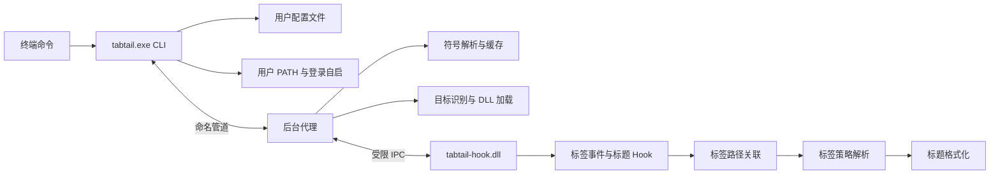

# TabTail 设计文档

扩展设计：[01 · 标签固定、保护、目录锁定与外观](01-tab-protection-and-appearance.md)，按阶段规划快捷操作、行为保护、字体、文字颜色、标签背景色与状态图标。

- 状态：完整产品设计；v0.5 已实现目录规则与双语 TUI，保留精确文件版本的原生标题调用原型，实际能力与验收限制见 [实现状态](implementation.md)。
- 设计日期：2026-11-16。
- 正式名称：TabTail；简称：TT；终端命令：`tabtail`。
- GitHub 仓库：`TabTail`；配置文件：`tabtail.toml`；C++ 命名空间：`tabtail`。
- 英文定位：Customize Windows Explorer tab titles with configurable path depth.
- 中文描述：自定义 Windows 资源管理器标签页的路径显示层级。
- 技术路线：C++ CLI、后台代理和 Explorer 进程内 DLL。
- 首版目标平台：Windows 11 x64，具体支持的系统版本以技术验证和兼容性测试结果为准。

## 1. 目标与范围

用户通过终端管理 Windows 11 原生资源管理器标签页的标题显示规则。程序安装后注册到当前用户的 PATH，支持调整目录显示层级、启停标题定制、查看运行状态，以及显式重启资源管理器。

核心场景：同时打开多个项目目录时，避免标签页都显示相似且被截断的完整路径前缀。用户可以选择显示当前目录、最后 N 级目录或完整路径。

基础层必须支持每个标签页独立选择显示深度。全局层级是默认值，持久化目录规则支持通配符；优先级为标签显式覆盖、按列表顺序首个命中的目录规则、全局默认。没有显式覆盖的标签自动匹配目录规则，未命中时继承全局默认；同一窗口内的标签可以同时使用 1 级、3 级和完整路径。两个标签即使打开相同目录，也可以采用不同层级。分隔符首版仍使用全局设置。

以 `D:\100_Projects\110_Daily\VoiceInput` 为例：

| 设置 | 标题 |
| --- | --- |
| `depth 1` | `VoiceInput` |
| `depth 2` | `110_Daily\VoiceInput` |
| `depth 3` | `100_Projects\110_Daily\VoiceInput` |
| `depth all` | `D:\100_Projects\110_Daily\VoiceInput` |

首版包含：用户级安装与卸载、PATH 管理、全局配置持久化与运行时应用、标签级层级覆盖与恢复继承、标签枚举、标题层级与分隔符、启停、可选登录自启、状态诊断、资源管理器重启。

v0.6 采用 TUI 作为日常交互入口，保留现有 CLI，已实现目录规则、中英文界面及全局标签宽度。暂不包含：桌面图形界面、独立标签页手动命名、正则表达式、自动切换新标签页、替换文件管理器、跨用户会话控制、ARM64 和 Windows 10。标题超出设置的最大宽度时仍由 Explorer 截断。

本文描述完整目标接口；实际实现以 --help 和实现状态为准。v0.4 使用精确哈希适配、短时 UI 线程消息桥接、MinHook、逐标签策略及 10 秒恢复租约。登录自启、通用符号解析、正常退出 Shell、自动升级和热卸载尚未实现；当前 stop 恢复 Shell 普通显示名并保留观察代理，agent stop 退出代理。

## 2. 技术依据与首要验证

### 2.1 已核查的参考实现

已阅读 Sleek WinTabs 的 README、许可证及 `sleekwintabs.wh.cpp`，参考提交：

`2b1dc831b6c474f7fc2c3a5360efd716c18694ed`

源码通过 Windhawk 的符号解析和 Hook 能力，拦截 `explorerframe.dll` 中的 `CExplorerFrame::SetFrameTitle`。标题设置调用包含标签标识，源码对传入的标题字符串截取最后一个路径分量，再调用原函数。

这验证了一个可研究的标题修改入口，但尚不能证明本项目可以直接实现任意层级：

- 当传入标题只有 `VoiceInput` 时，仅靠字符串截取不能得到 `110_Daily\VoiceInput`。
- 参考实现没有展示覆盖全部标签页的完整路径查询机制。
- 参考实现依赖 Windhawk；独立工具需要自行提供符号定位、Hook、加载、生命周期和设置通信。
- 上游声明测试过 Windows 11 build 26100.9278，不等于本项目已经兼容该版本。

复用上游代码时保留 MIT 版权和许可证声明。首版仅研究标题功能，不接入自动切换标签页功能。

### 2.2 技术验证的完成条件

在实现完整产品前，先用最小 C++ 原型验证以下能力：

1. 记录目标机器的 Windows build、`explorerframe.dll` 版本及符号标识。
2. 正确解析并验证目标符号，在匹配的 x64 进程中安装标题 Hook。
3. 分别观察前台标签、后台标签、新建标签、导航及重命名时的标题参数。
4. 找到完整路径来源，并建立路径与对应标签的可靠关联。
5. 同一窗口内为不同标签分别设置 1 级、3 级和完整路径，覆盖前台与后台标签；确认相同目录的两个标签也能使用不同层级。
6. 修改某个标签的层级，只刷新目标标签；修改全局默认层级，已设置覆盖的标签保持自身层级，其余标签继承新值。
7. 验证覆盖在导航、重命名和标签切换后保留；关闭后清理，重新打开相同路径不继承旧标签覆盖。
8. 验证恢复继承后的更新方法，以及禁用后恢复原始标题的方法。

完整路径来源按以下顺序研究：现有标题中的完整路径、导航调用中的绝对 PIDL、标签对象关联的 Shell 接口。PIDL 转换仅对文件系统位置尝试获取文件系统路径；虚拟位置保留 Shell 显示名称。

不能只用顶层窗口句柄或当前活动标签路径充当所有标签的路径。若无法验证路径与标签的关联，应明确报告该场景不支持，不得将“偶尔能截取完整路径”作为多级显示功能完成。

此阶段若失败，先修订集成方案，再决定是否继续独立 DLL 路线。

## 3. 用户命令

### 3.1 典型使用流程

```powershell
# 解压后首次运行：复制到用户安装目录并注册 PATH
.\tabtail.exe install

# 在获得新 PATH 的终端进程中使用命令
tabtail config set depth 2
tabtail start
tabtail status

# 修改规则，通知已运行的组件应用
tabtail config set depth 3
tabtail config set separator " / "

# 列举标签，复制 tab_id；下例 tab-a 和 tab-b 仅为占位符
tabtail tabs list
tabtail tabs set tab-a --depth 1
tabtail tabs set tab-b --depth 3
tabtail tabs set tab-b --depth all
tabtail tabs reset tab-b

# 需要时显式重启资源管理器
tabtail explorer restart

# 恢复原生标题行为
tabtail stop
```

### 3.2 命令表

| 命令 | 语义 |
| --- | --- |
| `install` | 用户级安装并注册 PATH，保留既有配置，不自动启用 Hook |
| `uninstall [--purge]` | 禁用功能、移除自启与本工具登记的 PATH 项；默认保留配置和日志 |
| `path add` | 将已安装的命令目录加入当前用户 PATH，重复执行不重复添加 |
| `path remove` | 移除本工具登记的 PATH 项，保留其他 PATH 内容 |
| `path status` | 显示用户 PATH 登记状态与当前进程能否找到命令 |
| `start` | 持久化启用意图，启动当前会话后台代理，尝试接入 Explorer |
| `stop` | 持久化禁用意图，停用标题改写并停止后台代理 |
| `agent start\|stop\|status\|run` | 代理生命周期入口；agent start 始终先观察，start 才启用定制；agent stop 恢复并退出 |
| `status [--json]` | 显示配置、代理、Explorer、Hook 和实际生效状态 |
| `config show [--json]` | 查看当前持久化配置 |
| `config set <key> <value>` | 校验、保存配置，并向运行中的代理发送应用请求 |
| `config reset` | 恢复显示规则默认值，保留启停与自启状态 |
| `tabs list [--json]` | 枚举当前会话可识别的标签，展示 tab_id、窗口、路径、有效层级及其来源 |
| `tabs set <tab_id> --depth N\|all` | 为指定存活标签设置层级覆盖，仅刷新该标签 |
| `tabs reset <tab_id>` | 清除指定标签的覆盖，立即继承当前全局默认层级 |
| `preview <path> [--depth N\|all]` | 在本地预览标题，既不加载 DLL，也不修改配置 |
| `autostart enable\|disable\|status` | 设置或查询当前用户登录自启 |
| `explorer restart [--force] [--yes]` | 重启当前用户、当前会话的 Explorer；默认先尝试正常退出 |
| `doctor [--json]` | 检查系统版本、架构、符号、PATH、代理和 Hook 兼容性 |
| `--help` / `--version` | 显示帮助或程序版本 |

`config set` 首版只接受 `depth` 和 `separator`。启停和自启通过专用命令修改，避免同一操作出现多套语义。`separator` 支持 `\`、` / `、` · ` 三种值。

`config set depth` 和 `config reset` 只修改全局默认值，不清除现存标签的独立覆盖。`tabs reset` 恢复继承，不是关闭标题定制。`tabs` 命令需要正在运行且已接入目标 Explorer 的代理；未运行时返回明确错误，不把请求暂存到其他标签。当前 v0.4 已实现原生 GUID 映射、start/stop 和逐标签调用确认；仅匹配的 ExplorerFrame 文件可以定制。观察模式的 set/reset 返回 5 表示策略已保存但标题未应用。

### 3.3 交互与退出码

命令默认输出简洁中文；`--json` 输出版本化 JSON，结果写入 stdout，诊断写入 stderr。非交互环境遇到需要确认的重启操作时，必须显式传入 `--yes`。

| 退出码 | 含义 |
| --- | --- |
| `0` | 请求已完成；应用配置时已收到所需确认 |
| `1` | 一般运行错误 |
| `2` | 参数或配置无效 |
| `3` | 当前系统、架构或目标模块不受支持 |
| `4` | 权限不足或目标进程不可访问 |
| `5` | 配置已保存，但运行时应用失败、超时或仅部分进程确认 |
| `6` | 用户取消，或非交互环境缺少必要确认参数 |

代理未启动时，保存配置返回成功并显示“已保存，启动后生效”。代理运行时不得把“已写入文件”输出成“所有标签已更新”。

### 3.4 TUI 简体中文与英文（v0.5 已实现基础交互）

TUI 首版同时支持简体中文（zh-CN）和英文（en）。所有页面标题、菜单、按钮、字段标签、状态、帮助、确认框、校验及 TabTail 自身错误说明均提供两种语言；不将中英混排作为默认呈现方式。终端输入法、字体及外部系统返回文本不由 TUI 翻译或安装。

#### 语言选择与保存

- 语言选项使用各自语言自称：`自动 / Auto`、`简体中文`、`English`，无需先理解当前界面才能切换。
- 首次启动默认自动选择：系统首选界面语言属于简体中文时使用 zh-CN，其他情况或检测失败使用 en。繁体中文不作为已支持语言，也不自动替换为简体中文。
- 全局设置新增“界面语言 / Interface language”。用户明确选择后保存至当前数据目录的 tabtail.toml；下次启动恢复。
- 目标启动参数 `tabtail tui --lang auto|zh-CN|en` 只覆盖本次 TUI 会话，不写入配置；未指定时读取保存值，auto 再检测系统。非法值明确报错。
- TUI 内修改语言即时生效，F7 也可在编辑器内切换而保留草稿；切换保留当前页面、选中标签和搜索文本。关闭当前 TUI 不影响后台代理。
- 切换语言只修改界面偏好，不改变规则内容、目录顺序、启停状态、逐标签覆盖或真实 Explorer 标题，不触发标题重新应用。

schema 2 已增加以下字段；v0.5 可读取旧 schema 1，下次成功保存时升级。旧版无法读取 schema 2。

```toml
[ui]
language = 'auto' # auto | zh-CN | en
```

#### 翻译边界与实现约定

- 文件系统路径、用户规则名称、用户输入、Explorer 原始显示名以及计算出的标题按原样呈现；语言切换不翻译目录名。
- CLI 命令名、配置键、规则 ID、通配符和机器可读 JSON 键保持稳定。现有 CLI 中文输出无需随本项需求一并重写。
- TUI 使用稳定消息 ID 和参数化模板集中管理两份文本资源，不在控件内散落硬编码文案。TabTail 错误以稳定代码及参数转换为界面语言；Windows 原始诊断可在详情中保留系统语言文本，不承诺改写系统消息。
- 缺失译文回退至英文，同时在开发校验中报告；发布前检查两套资源键一致、参数一致、没有缺失项。
- 中英文使用一致的快捷键，控件布局按实际可用列宽自适应。中文显示宽度、Unicode 字符边界和组合字符不能用 UTF-8 字节数或简单字符数代替；长路径优先保留有区分度的末端，并能查看完整内容。
- 自动刷新及语言切换不打断路径输入或终端中文输入法组合状态；完整中文输入体验在 Windows Terminal 中实测，不自行实现输入法。

v0.5 当前对自身错误提供本地化概述，底层校验/IPC 详情保留原文；稳定的错误代码与参数化翻译仍待完善。生产组件和伪终端键盘流程已验证，中文输入法组合和真实窗口连续缩放仍待人工验收。

验收覆盖：首次自动选择、手工切换及重启保存、--lang 会话覆盖、非法值和检测失败、两种语言全流程、输入法输入与中文路径、窗口缩放及最小尺寸、长英文/中文文本布局，以及切换语言后后台策略和真实标题保持不变。

## 4. 总体架构



### 4.1 CLI

CLI 是短时运行进程，处理参数、配置、安装、状态查询及重启操作。常规命令完成后退出。终端展示与 JSON 输出均在 CLI 完成。

### 4.2 后台代理

使用同一个 EXE 的内部入口 `agent run`，以无控制台窗口方式启动。每个用户会话仅允许一个实例，通过含用户 SID 和会话 ID 的互斥量保证。

v0.3 采用观察模式作为接入步骤：`agent start` 不修改 enabled 或加载 DLL；按用户、会话和数据目录隔离实例，标准数据目录正常使用，临时目录用于测试。它通过 Shell COM 集合枚举独立浏览器子窗口与路径，再关联策略基础层。CLI 标识是代理持有的 COM 对象所对应的观察生命周期标识。v0.4 通过经过版本和对象布局校验的浏览器 HWND 关联原生 GUID，二者分开提供。

代理负责识别当前用户、当前会话的 Explorer，管理符号与模块版本信息，加载匹配 DLL，转发配置，监控 Explorer 重启和新进程出现，并汇总运行状态。优先使用事件通知，必要的补偿扫描采取有界低频策略，不高频轮询标签标题。

`start` 立即返回前等待首次接入结果，但不无限等待。代理可在 Explorer 暂时不存在时保持等待状态；CLI 必须明确输出“等待 Explorer”，而非“标题已生效”。

### 4.3 Explorer 集成 DLL

DLL 负责进程内 Hook、标签与路径关联、每个标签的有效显示策略、标题计算及配置快照。代理管理标签覆盖，DLL 在标题更新时根据目标标签读取对应策略，不能以单个可变的全局 depth 代表所有标签。内部只处理 Unicode；对外 JSON 使用 UTF-8。

`DllMain` 只做最小初始化。符号下载、复杂初始化、IPC 等待与 Hook 安装通过后续初始化入口完成，不在加载器锁内执行。

目标是让 Hook 热路径只读取已验证的内存配置和路径映射，不进行网络请求、磁盘读取或同步等待 CLI。当前 v0.4 原型仍在 UI 线程校验模块/对象并查询实时 Shell 路径，使用互斥锁；性能与阻塞边界尚未达到此目标。实现重入保护；模块自身异常不得跨越 Hook 边界传播。符号或签名不匹配时不安装 Hook；这能降低风险，但不能保证未公开接口绝不导致 Explorer 崩溃。

## 5. 配置与标题规则

### 5.1 存储与默认值

配置位置：`%LOCALAPPDATA%\TabTail\tabtail.toml`。

```toml
schema_version = 2
revision = 1
enabled = false
autostart = false

[display]
depth = 2
separator = '\'
```

`depth` 接受整数 `1..32`；CLI 的 `all` 保存为 TOML 字符串 `"all"`，不使用 `0` 表示完整路径。`revision` 每次有效修改递增。`enabled` 是持久化意图，实际运行状态由代理查询获得。

安装后默认禁用；首次 `start` 启用默认两级显示。完整路径模式保留路径本身的分隔符；自定义分隔符仅用于最后 N 级模式。

### 5.2 路径规则

1. 优先使用经验证、与标签关联的完整文件系统路径。
2. N 只计算文件夹分量，盘符、UNC 服务器和共享名不计入层级。
3. N 超过实际文件夹数量时显示全部文件夹分量，不额外补盘符或共享前缀；需要完整位置时选择 `all`。
4. 驱动器根目录和 UNC 共享根目录优先保留 Explorer 原始显示名称；没有名称时分别使用 `D:\`、`\\server\share`。
5. 此电脑、主页、回收站、搜索结果等虚拟位置保留 Shell 原始标题。
6. 路径暂不可用时保留 Explorer 标题，标记该标签为降级状态，不使用其他标签的路径猜测。
7. 扩展长度路径的内部前缀只在明确识别后做显示转换，不改动真实路径，不以 `MAX_PATH` 为上限。
8. 文件夹重命名和导航完成后更新映射；关标签或关窗口时清除映射，避免对象地址复用造成串标题。

| 路径或位置 | 设置 | 预期 |
| --- | --- | --- |
| `D:\A\B\C` | 2 级 | `B\C` |
| `D:\A\B\C` | 2 级，分隔符 ` / ` | `B / C` |
| `D:\A` | 3 级 | `A` |
| `D:\` | 任意 | 原始磁盘显示名称；回退为 `D:\` |
| `\\nas\share\work\project` | 2 级 | `work\project` |
| `\\nas\share` | 任意 | 原始共享显示名称；回退为 `\\nas\share` |
| `D:\项目\语音输入` | 2 级 | `项目\语音输入` |
| 此电脑、回收站 | 任意 | 原始显示名称 |

### 5.3 配置写入和应用

配置更新在用户级写入锁下执行：重新读取当前配置、校验、生成新 revision、写入同目录临时文件，然后原子替换。失败时保留上一份有效配置；发现损坏配置时报告具体位置，不静默覆盖。

写入后，CLI 通过代理将新快照发给已接入的 DLL。DLL 确认已接收 revision，并通过经验证的 Explorer 线程上下文请求标题刷新。禁止从任意 IPC 工作线程直接调用未经线程安全验证的 Shell 对象。

需要区分“配置已接收”和“既有标签已重绘”。`status` 分别显示持久化 revision、各进程确认 revision 和标题刷新结果。目标是现有标签即时更新；若首阶段只能保证下一次导航更新，命令须明确输出该限制，且不满足最终即时更新验收条件。

手工编辑配置后，通过 `start` 或后续 `config set` 触发读取与验证；首版不承诺外部编辑实时监听。

### 5.4 标签级策略与身份

目标有效策略的优先级为：**标签显式覆盖 > 按列表顺序首个命中的已启用目录规则 > 全局默认层级**。v0.5 已实现完整三级优先级，目录规则见 5.5 节。显式覆盖可以是 `1..32` 或 `all`；继承是另一种独立状态，不能将 `all` 当成“没有覆盖”。每次渲染都先解析该标签的有效策略，再将路径与策略交给格式化模块。

| 标签 | 全局默认 | 标签覆盖 | 有效层级 |
| --- | --- | --- | --- |
| A | 2 | 1 | 1，来源为标签 |
| B | 2 | 3 | 3，来源为标签 |
| C | 2 | `all` | 完整路径，来源为标签 |
| D | 2 | 无 | 2，来源为全局 |

全局默认从 2 改为 4 后，只有 D 的有效层级变为 4。对 B 执行 `tabs reset` 后，B 继承当时的默认值 4。

基础领域模型按以下职责划分：

- `DisplayDefaults`：持久化的默认层级与分隔符，来自 `tabtail.toml`。
- `TabIdentity`：当前运行期内的标签身份，关联用户会话、进程创建时间、frame 生命周期和标签 GUID；具体映射由 P0 验证。
- `TabState`：路径、原始标题、可选层级覆盖、有效策略及其来源、更新序号和刷新状态。
- `PolicyResolver`：纯策略解析，目标输入为默认值、有序目录规则、当前目录和单标签覆盖，输出有效策略、来源和命中规则 ID；不依赖 Explorer 或修改文件。
- `TitleFormatter`：只处理路径和已解析的策略，不选择当前活动标签、不自行读取全局配置。

v0.2 中已落地的对应关系是：`DisplayOptions` 表达显示默认值与解析结果中的显示参数，`DepthOverride` 表达显式数字或完整路径，外层 `optional<DepthOverride>` 表达是否继承；`resolve_policy` 实现策略解析，`TabRegistry` 管理标签身份、策略与生命周期，`format_tab_title` 将标签快照中的路径与有效策略交给格式化模块。持久化配置通过 `Config::display_options()` 转换为显示默认值，TOML 格式保持兼容。

`TabRegistry` 的注册表操作由互斥锁保护，返回值均为副本。未来代理负责生成每次启动唯一的运行期 ID；Explorer 适配器负责提供经验证的原生身份。该模块不自行发现真实标签，也不声称已经验证原生身份映射。DLL 集成时应发布只读策略快照供 Hook 消费，避免将代理侧全量更新和格式化之外的工作放入 Explorer 标题调用。

v0.3 的 `ShellTabTracker` 已生成每次代理启动唯一的运行期 ID，持有 COM 对象避免释放后地址复用，结合独立浏览器子窗口和进程创建时间跟踪标签。扫描不完整时不退休身份，并拒绝设置策略；两次完整扫描缺失后清除标签。v0.4 已增加对应原生 GUID 的只读映射，CLI 观察标识仍不能替代原生 GUID。事件驱动生命周期、跨窗口拖动和完整实机验收仍待完成。

CLI 使用代理生成的不透明 `tab_id`，不直接暴露或接受对象指针。标识在该次代理运行期间不会重用；不能使用标签位置、窗口句柄、PID 或文件夹路径单独作为身份。过期或已关闭的 tab_id 返回错误，不重定向到当前活动标签。

首版标签覆盖仅存放于运行时内存，不把易失的 tab_id 写入 TOML。覆盖跟随标签导航和切换；关闭标签、停止代理或重启 Explorer 后失效。新建标签自动匹配当前目录规则，未命中则继承全局默认，不复制其他标签的覆盖。目录规则按 5.5 节持久化，不使用易失 tab_id。

恢复继承在新交互中称为“自动匹配规则”：先匹配目录规则，再回退全局默认；它与关闭标题定制的语义不同，后者恢复 Explorer 原始行为。虚拟位置仍保留 Shell 标题，即使已为该标签设置深度；导航回文件系统位置后使用该标签原有覆盖。

`tabs list` 必须显示原始路径、有效 depth、目标 `source = tab|rule|global` 及刷新状态，便于从路径相同的多个标签中准确选择。若标签跨窗口移动时无法验证身份连续性，应将其视为旧标签关闭、新标签创建，明确清除覆盖，不能依据相同路径猜测迁移。

### 5.5 目录规则与通配符（v0.5 已实现）

用户确认支持下述正向通配符语法；不支持正则表达式、前置 ! 排除或字符集合否定。本文是 TabTail 自身的匹配约定，不宣称与 Git ignore、PowerShell 或任意 Shell 完全兼容。

#### 规则优先级与生命周期

- 全局默认与目录规则持久化，单标签覆盖仅在本次代理运行期有效。
- 优先使用标签显式覆盖；没有覆盖时从上到下选择首个已启用且匹配的目录规则；无匹配时使用全局默认。不再自动按“路径最具体”排序。
- TUI 提供上下移动、启用/停用和命中说明，不引入隐藏的优先级分数。修改顺序前预览受影响标签。
- 每次导航后按当前完整目录重新匹配。标签覆盖仍跟随标签；恢复自动匹配后立即依据当前位置解析。
- 规则可以设置 depth=1..32 或 all；也可选择 native 动作，保留当前 Shell 普通显示名。native 命中即终止目录规则查找；未命中则继续查找。
- 虚拟位置或未解析到文件系统路径时不执行目录匹配，保留 Shell 显示名。规则引擎只匹配路径字符串，不枚举、访问或修改目录。

#### 匹配语法

| 语法 | 精确定义 | 示例 |
| --- | --- | --- |
| `*` | 同一路径段中的零个或多个 Unicode 字符，不跨分隔符 | `D:\Projects\*\src` |
| `?` | 同一路径段中的一个 Unicode 标量字符，不跨分隔符 | `D:\Projects\App?\src` |
| `**` | 必须独占一个路径段，匹配零级或多级目录 | `D:\Projects\**\src` |
| `{src,docs,tests}` | 任选一个非空分支；允许有界嵌套，不做数字/字母序列展开 | `D:\Projects\**\{src,docs,tests}` |
| `[abc]` | 匹配集合中的一个字符 | `D:\Projects\App[ABC]` |
| `[0-9]`、`[a-z]` | 匹配一个 ASCII 范围字符；反向范围无效 | `D:\Projects\release[0-9]` |

`**` 匹配零级的例子：`D:\Projects\**\src` 同时匹配 `D:\Projects\src` 和 `D:\Projects\A\B\src`。尾部 `\**` 包含前面的目录自身及所有子目录。`a**b`、`***` 不视作递归通配符，直接报告语法错误；避免静默猜测。

模式锚定完整目录路径，不隐含“任意位置”或“包含子目录”。例如 `D:\Projects\*` 匹配其直属子目录，不匹配 Projects 本身及更深层目录。`*` 和 `?` 可以匹配以点开头的目录名，不提供隐藏目录特殊规则。

#### 多模式与例外目录

每条规则可以有多个 patterns，各模式为“或”关系：任意一个匹配即命中该条规则。patterns 不得为空，模式本身也不得为空。

不提供前置 ! 排除、[!abc] 或 [^abc] 字符集合否定；检测到这些写法时报告不支持的语法，不静默按其他规则解释。感叹号在普通目录名中仍是字面字符；精确目录模式始终按完整路径原样匹配。

需要为某些目录设置不同层级或保留原生标题时，添加一条更靠前的普通规则。例如先为 cache 及子目录设置 action=native，再为整个项目树设置 depth=3。两条规则均使用正向匹配，列表顺序直接决定结果。

#### Windows 路径与字面量

- 支持绝对盘符路径与 UNC 路径；盘符、服务器和共享根必须为字面量，通配符作用于根之下的目录段。
- `/` 和 `\` 均作为目录分隔符；反斜杠不兼任转义符。统一分隔符、移除非根末尾分隔符、规范化 `.` / `..` 后匹配；不允许越过根。
- 将可识别的扩展长度盘符/UNC 前缀转换成相同匹配形式；不通过磁盘访问解析 junction、符号链接或短文件名，因此路径别名不保证等价。
- 默认使用 Windows ordinal 忽略大小写语义，避免受当前地区语言影响；规则提供 case_sensitive=true 以匹配启用区分大小写的目录场景。字符范围仅接受 ASCII 端点，Unicode 字符可用显式集合。
- TUI 同时提供“精确目录”和“通配符”模式。精确目录模式不解释特殊符号；通配符模式可用 `[[]`、`[]]`、`[{]`、`[}]` 表示字面括号。普通目录名中的感叹号无需转义。
- TOML 推荐使用单引号字符串书写 Windows 路径。TUI 显示路径和匹配解释，用户不必手工处理 TOML 引号。
- 不支持正则、extglob、环境变量/波浪号展开、`{1..9}` 序列展开、POSIX 字符类和隐式相对路径。普通 `+`、`(`、`)`、`^`、`$` 按字面量处理，不解释为正则。

#### 配置与交互

以下为 schema 2 的目录规则，与其他顶层字段和 [display] / [ui] 组合。v0.4.1 无法读取 schema 2；升级后请勿使用旧程序写入配置。

```toml
# 与其他顶层字段、[display] 组合；[[rules]] 的顺序即匹配顺序。
[[rules]]
id = 'dependencies'
name = '依赖目录'
enabled = true
match = 'glob'
patterns = ['D:\Projects\**\node_modules\**']
action = 'depth'
depth = 1
case_sensitive = false

[[rules]]
id = 'project-default'
name = '项目默认'
enabled = true
match = 'glob'
patterns = ['D:\Projects\**']
action = 'depth'
depth = 3
case_sensitive = false
```

TUI 提供“标签页 / 目录规则 / 全局设置”，规则编辑器提供一个或多个正向路径模式，底层序列化为 patterns；不提供排除模式输入项。可以从当前标签创建规则、移动规则顺序、预览受影响标签。匹配测试输入路径后，显示最终动作/层级、命中规则 ID、命中的路径模式。标签来源列显示“独立 / 规则名称 / 全局”，恢复按钮使用“自动匹配规则”。

配置保存和运行时应用继续分开确认；失败时保留上一份有效快照。规则预编译并有界执行，不能在 Explorer Hook 内展开组合或枚举文件。建议初始限制：512 条规则、每条 64 个模式、每模式 4096 个 Unicode 标量、花括号嵌套 4 层及最多 256 个展开分支；超过限制明确拒绝。实现时同时限制编译状态和匹配工作量，避免递归回溯阻塞 UI 线程；超限保留 Shell 原始标题并报告降级。

验证必须覆盖：所有语法、空目录段/零级 **、尾部 ** 包含自身、多模式或关系、拒绝不支持的否定写法、规则排序、native 动作、大小写与 Unicode、UNC/根/扩展路径、非法/超限模式、目录导航重新匹配、标签覆盖优先、保存后重启保留规则，以及代理和 DLL 对同一路径给出一致结果。

## 6. 安装、PATH 与自启

### 6.1 用户级目录

```text
%LOCALAPPDATA%\TabTail\
  bin\
    tabtail.exe
  versions\
    <version>\
      tabtail-hook.dll
      manifest.json
  tabtail.toml
  install-state.json
  symbols\
  logs\
```

分发包为 x64 ZIP，包含 EXE、DLL、许可证和简短使用说明。安装目录版本化存放 DLL，避免覆盖已被 Explorer 加载的文件。升级的精确替换流程在具备首版能力后实现；遇到正在使用的 EXE 或 DLL 时明确报告，不尝试直接覆盖。

### 6.2 PATH 管理

修改当前用户注册表 `HKCU\Environment` 下的 `Path`，追加安装目录的 `bin`。不使用当前进程合并后的 PATH 覆盖用户 PATH，也不通过 `setx PATH ...` 重写整个值。

读取时保留原值和注册表类型。比较候选项时处理外层引号、大小写和尾部分隔符，并展开已知环境变量作等价判断；实际写回时保留其他项的原始文本及顺序。不存在用户 PATH 时创建有效值。处理不存在、空值、中文路径和含空格路径。

写入后通过带超时的 `WM_SETTINGCHANGE` 广播通知，主题为 `Environment`。广播失败时保留已经成功写入的结果，同时报告通知失败。

PATH 变更不保证更新已运行终端的环境块。安装输出提示完全退出并重新启动终端应用；只开新标签页可能仍继承旧环境。子进程不能替调用它的 PowerShell 修改 `$env:Path`；可展示仅影响当前会话的手动刷新命令。

安装状态记录本工具是否实际追加了 PATH 项。卸载时仅删除本工具登记且仍匹配的项，不回滚整个 PATH 快照，不删除原本由用户自行配置的等价项。注册表不支持通用原子读改写，提交前重读并在冲突时重试，避免覆盖其他安装程序的并发修改。

### 6.3 登录自启

`autostart enable` 在 `HKCU\Software\Microsoft\Windows\CurrentVersion\Run` 写入带引号的绝对命令路径和 `agent run` 参数，无需安装系统服务。禁用时只移除本工具的值。

默认关闭自启。登录时代理读取 `enabled`；为 false 时退出。因而 `stop` 后即使仍登记自启，下次登录也不会自动重新启用标题定制。

### 6.4 卸载

先执行等价于 `stop` 的禁用流程，再移除自启和拥有的 PATH 项。默认保留配置、日志和诊断信息；`--purge` 清理本工具数据。

已加载 DLL 可能无法立即删除。第一版不强行从 Explorer 卸载 DLL：将其切换为透传模式，在状态中报告“禁用，DLL 待 Explorer 退出后释放”，记录待清理项。清理失败不能伪报卸载完成，也不因此自动重启 Explorer。

## 7. 进程接入、符号与兼容性

### 7.1 目标识别与加载

根据进程映像的可信系统路径、用户 SID、会话 ID、架构与所需模块确认目标。仅处理当前用户当前会话的 Explorer。可能存在多个 Explorer 进程，状态与应用确认按 PID 分别维护。

只加载安装目录内的匹配架构 DLL，不从当前工作目录或任意 PATH 目录寻找模块。进程内加载属于需要先验证的实现点；对访问被拒绝或架构不符的进程输出清晰错误，不自动提权或反复重试。

### 7.2 符号定位与 Hook

使用微软符号服务和本地缓存研究解析目标函数。按实际模块的 PDB GUID/Age 及版本绑定符号，Hook 前验证地址范围、目标签名与适配记录，不把某个 build 的裸地址用于其他 build。

v0.4 使用 MinHook 1.3.4，研究阶段按 PDB 符号定位，运行时采用精确文件哈希及内存 PDB/布局/入口校验。0.11.0 已为标题／枚举、保护／锁定、选择／新建、重排及外观身份接入三个模块的 DbgHelp 符号解析和独立布局契约，具体准入以 [05：符号兼容](05-symbol-compatibility.md) 为准。只有文档中记录并实测通过的系统组合标记为 supported。首次可能需要下载符号；离线时仅使用匹配缓存，不在 Hook 线程内下载。

若代理计算模块相对偏移后传给 DLL，DLL 必须再次校验自身已加载模块身份及偏移范围，按目标进程模块基址定位，不能直接使用代理进程中的绝对地址。

### 7.3 生命周期与恢复

标签标识应至少由进程身份（含创建时间）、窗口或 frame 生命周期标识和标签 GUID 组成，具体键由原型确认。原始标识可能复用时还需要生命周期代次。关闭事件必须同时清除路径映射和层级覆盖。涉及 Explorer 对象指针时必须验证生命周期与线程归属，不长期持有未经引用管理的裸指针。

正常 `stop`：先保存禁用意图，通知所有可达 DLL 停止改写并请求恢复原始标题，收到确认后关闭代理。原始标题应来自 Explorer 的原始调用或经验证的刷新机制，不以“之前格式化的标题”作为原始值。

代理异常退出或 IPC 失联时，DLL 在有界租约过期后停止改写并尝试恢复标题。恢复无法完成时状态明确提示需要下一次导航或显式重启。DLL 可以继续驻留为透传状态，新的代理能够重新连接；不通过在线强制卸载来实现 stop。

对同一 Explorer 进程连续初始化失败设置重试上限，禁止不停重启 Explorer。检测到可能修改相同入口的第三方插件时，诊断报告潜在冲突，不覆盖未知 Hook。

## 8. IPC 与运行状态

使用命名管道，名称包含用户 SID 和会话 ID，ACL 仅允许当前用户及必要的系统身份，拒绝远程连接。CLI 到代理、代理到 DLL 分别建立版本化协议。

请求包含 `protocol_version`、`request_id`、命令、目标 revision 和负载长度；响应包含结果码、诊断及各目标的应用状态。限制报文大小、连接时长及请求时长，对端断开不得阻塞 Explorer UI 线程。

标签操作另外包含目标 tab_id、代理运行期标识及该标签策略更新序号。DLL 必须确认目标仍存活；全局配置 revision 与标签覆盖更新序号分开管理。乱序到达的旧策略不能覆盖新策略；标签关闭后到达的请求应失败。单标签修改只刷新目标，全局更新只刷新有效策略发生变化的标签。

除校验 ACL 外，连接双方核查对端进程身份及会话，避免仅凭可预测的管道名称信任任意服务端。不暴露任意 DLL 路径加载、任意进程操作或任意代码执行接口。

运行状态至少包含：安装路径、PATH 登记状态、期望启停状态、代理 PID、Windows build、各 Explorer PID、DLL 版本、符号匹配结果、配置确认 revision、刷新结果和最近错误。

每个可识别标签还应报告 tab_id、所属窗口与进程、路径、是否具有显式覆盖、有效层级、策略来源、确认的策略更新序号和刷新结果。

每个 Explorer 目标分别显示 `waiting`、`loading`、`active`、`degraded`、`unsupported`、`disabled` 或 `unreachable`。代理运行不能直接等同于 Hook 已生效；多进程中只有部分成功时，整体显示部分生效。

## 9. 资源管理器重启

命令：`tabtail explorer restart [--force] [--yes]`。

重启会影响桌面、任务栏和文件夹窗口，可能中断 Explorer 正在处理的操作。命令执行前显示影响范围并确认；非交互环境需要 `--yes`。`--force` 允许在正常退出超时后强制终止，`--yes` 只跳过确认，两者含义独立。

执行步骤：

1. 枚举并确认当前用户、当前会话的目标进程，记录 PID 与创建时间。
2. 暂停代理的自动接入，持久化当前配置，不改变 enabled 状态。
3. 通过原型验证过的正常退出机制尝试结束 Explorer，并进行有限等待；仅关闭文件夹窗口不算完成 Shell 重启。
4. 若目标仍在且未指定 `--force`，报告超时并恢复代理监控；不自动升级为强制结束。
5. 指定 `--force` 时只终止已核验的目标进程，终止前复查创建时间，避免 PID 复用。不得按进程名杀死其他用户会话。
6. 先观察系统是否已经重新启动 Shell；必要时从系统可信路径以当前普通用户令牌启动 Explorer，避免重复启动或从提权上下文错误启动。 v0.4.1 已允许管理员终端调用：在结束 Explorer 前校验同用户同会话的桌面上下文，优先使用普通令牌通过 CreateProcessWithTokenW 启动；原桌面本身已提权且无普通令牌时保持原桌面权限。
7. 等待新 Shell 就绪并恢复代理监控；若 enabled 为 true，接入新进程并确认配置。

正常退出的准确机制必须由技术验证确定，不将未经验证的内部消息当成稳定公开 API。如果没有可靠的正常退出实现，命令应说明限制并要求用户显式选择强制模式。

结果分别报告 Shell 重启和标题功能恢复是否成功。首版不承诺恢复全部原窗口、标签、排列及选择状态。安装、配置更新、Hook 失败和卸载均不隐式触发 Explorer 重启。

## 10. 工程结构与技术选择

采用 C++20、MSVC x64、Windows SDK 与 CMake。语言标准以工具链支持和实际需要为准，不要求 C++23。依赖通过固定版本或提交接入，不跟随浮动分支。

| 组件 | 方案 |
| --- | --- |
| 参数解析 | CLI11，候选，原型后锁定版本 |
| TUI | FTXUI 7.0.3，固定归档及 SHA-256 |
| TOML 配置 | toml++ v3.4.0 单头文件 `toml.hpp`，纳入源码并校验 SHA-256，无需独立链接 |
| JSON 输出与协议 | nlohmann/json，固定版本 |
| 函数 Hook | MinHook，候选，需验证目标入口兼容性 |
| 符号解析 | Windows DbgHelp 及微软符号缓存 |
| 日志 | 轻量文件日志，限大小轮换，默认不记录完整目录路径 |
| IPC、注册表、进程管理 | 原生 Win32 API，使用 RAII 管理句柄 |

```text
docs/design.md
CMakeLists.txt
src/
  cli/           参数、命令、输出、退出码
  tui/           双语资源、焦点与页面、异步后台工作线程
  app/           TUI / 规则 CLI 共用应用服务
  config/        配置校验、迁移、原子写入
  formatter/     独立路径解析与标题格式化
  policy/        默认策略、标签覆盖、身份与生命周期、有效策略解析
  installer/     用户级安装、PATH、自启、卸载
  agent/         单实例、目标监控、接入、状态聚合
  ipc/           协议、管道、身份验证、超时
  symbols/       符号缓存、模块身份与兼容性
  hook/          DLL 初始化、Hook、路径映射、标题恢复
  platform/      Win32 资源封装、进程与 Shell 重启
tests/
  unit/
  integration/
packaging/
  licenses/
```

核心边界：`PolicyResolver` 解析单标签的有效显示规则；`TitleFormatter` 不依赖 Explorer，只消费解析后的策略；`ConfigStore` 持久化全局默认值，不存储易失标签身份，也不隐式重启系统组件；`PathRegistrar` 只修改用户 PATH；`ExplorerController` 集中实现重启；`HookAdapter` 封装随系统版本变化的内部接口，避免其扩散到 CLI。

## 11. 实施顺序与验收

| 阶段 | 交付 | 通过条件 |
| --- | --- | --- |
| P0：集成原型 | 最小加载、Hook、独立标签身份、路径关联、逐标签策略与刷新验证记录 | 同一窗口不同标签分别显示 1 级、3 级和完整路径；后台和相同路径标签不串策略；全局修改遵守覆盖优先级；关闭后清理；能够禁用并恢复 |
| P1：CLI 与策略基础 | 命令骨架、preview、默认值与标签覆盖解析、配置读写及退出码 | 路径边界正确；继承、显式 all 和数字层级分别处理；策略只作用于目标标签 |
| P2：安装与环境 | install、PATH、自启、uninstall | 用户级安装可重复执行，原 PATH 保留，终端重新启动后命令可发现 |
| P3：运行闭环 | 代理、IPC、tabs list/set/reset、配置应用、状态与启停 | 多进程分别确认 revision；单标签请求精确定位；乱序策略不回退；配置变化按覆盖规则刷新既有标签；代理失联能停用改写 |
| P4：重启与诊断 | explorer restart、doctor、故障处理 | 限定当前会话、超时可退出、强制模式显式选择、重启后按原意图恢复接入 |
| P5：发布验证 | ZIP、使用说明、许可证、兼容性记录 | 在记录的系统组合完成端到端验收，卸载遗留项可解释且可清理 |

测试重点是有风险和容易回归的边界：路径分量与特殊位置、配置并发及损坏、PATH 等价判断和保留、IPC 超时、部分应用、版本不匹配、进程重建、代理异常退出及卸载时 DLL 驻留。

策略基础测试必须覆盖同窗口不同层级、相同路径不同层级、全局变更不覆盖显式设置、reset 恢复继承、显式 all 与继承的区分、导航保留覆盖、关闭清理、旧标识失效和策略请求乱序。

涉及真实 Explorer 的测试在可恢复的测试会话或虚拟机进行。完整测试矩阵包括新旧终端、前后台标签、多窗口、多 Explorer 进程、导航和重命名、Explorer 正常及强制重启。以测试记录声明支持范围，不笼统宣称支持所有 Windows 11。

## 12. 待验证决策

以下是实施中的调查项，不需要用户先回答：

| 问题 | 验证产物 |
| --- | --- |
| 所有标签的完整路径如何取得并关联？ | 标题事件、导航事件与标签标识的对应记录 |
| 不同标签的独立策略如何绑定与清理？ | 相同路径不同层级、前后台标签、导航保留与关闭清理记录 |
| 已有标签如何即时刷新和恢复？ | 经验证的对象生命周期、调用线程与刷新流程 |
| 独立 DLL 加载、初始化和异常退出是否可靠？ | 最小原型、权限需求、失败恢复记录 |
| 所需符号在目标系统是否可获得？ | 模块/PDB 身份、符号匹配与缓存策略 |
| 正常重启 Shell 的机制是什么？ | 退出、自动重建观察、超时和强制回退记录 |

## 13. 参考资料

- [Sleek WinTabs 固定提交源码](https://github.com/SleekGPX/sleek-windhawk-explorer-tabs/blob/2b1dc831b6c474f7fc2c3a5360efd716c18694ed/sleekwintabs.wh.cpp)
- [Sleek WinTabs README](https://github.com/SleekGPX/sleek-windhawk-explorer-tabs/blob/2b1dc831b6c474f7fc2c3a5360efd716c18694ed/README.md)
- [Sleek WinTabs MIT License](https://github.com/SleekGPX/sleek-windhawk-explorer-tabs/blob/2b1dc831b6c474f7fc2c3a5360efd716c18694ed/LICENSE)
- [Microsoft：Environment Variables](https://learn.microsoft.com/en-us/windows/win32/procthread/environment-variables)
- [Microsoft：WM_SETTINGCHANGE](https://learn.microsoft.com/en-us/windows/win32/winmsg/wm-settingchange)
- [Microsoft：SetEnvironmentVariable](https://learn.microsoft.com/en-us/windows/win32/api/winbase/nf-winbase-setenvironmentvariablew)
- [Microsoft：Dynamic-Link Library Best Practices](https://learn.microsoft.com/en-us/windows/win32/dlls/dynamic-link-library-best-practices)
- [Microsoft：DbgHelp](https://learn.microsoft.com/en-us/windows/win32/debug/dbghelp)
